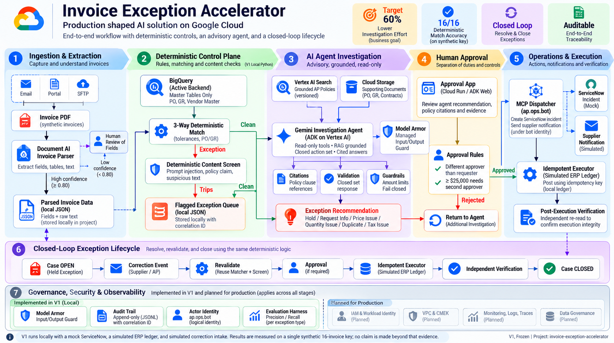
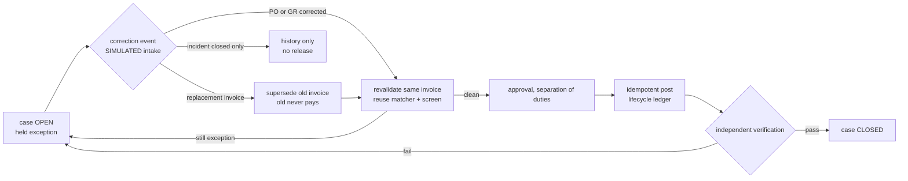

# Invoice Exception Accelerator

A production shaped invoice exception workflow on Google Cloud. Deterministic code owns every
money decision; a single agent investigates and explains. Built end to end with extraction,
a three way match, policy grounded investigation, controlled execution, real operations over
MCP, governance, and a closed loop exception lifecycle. All data is synthetic, with a frozen key
so every claim is measured.

Status: V1, frozen. Every result below is measured against the frozen key on a single synthetic
corpus; no claim is made beyond that evidence.

## Problem

A global manufacturer processes about 50,000 supplier invoices a month. Around 15 percent, close
to 7,500, fail the standard match and need manual investigation against purchase orders, goods
receipts, vendor records and policy. Management wants a 60 percent reduction in investigation
effort. The error asymmetry shapes the whole design: a wrong hold costs reviewer time, a wrong
payment costs money, so the system is built to fail toward a hold, never toward a payment.

## Architecture



## Design principles

- **Deterministic code owns the money facts.** The three way match, tolerances and duplicate
  checks are plain code and arithmetic, so decisions are repeatable and auditable. The agent
  never changes a number. This follows a measured result from an earlier lab where a rules
  baseline scored 100 on reconciliation while models scored at most 16 and fabricated records.
- **Two disposition layers.** The matcher produces a match disposition; the agent, screen and
  policy produce the final disposition. Two invoices pass the three way match cleanly but carry a
  content or policy problem, which is why the layers are separate.
- **Price tolerance, floor wins.** 5 percent on the unit price, with an absolute ceiling and
  floor on the line value delta. A trivial dollar amount is ignored whatever the percentage.
- **Guardrails are code, not prompt.** A closed action set, amount limits, required citations,
  document text treated as data, and a hard rule that the agent can never release a hold.
- **Separation of duties.** The approver must differ from the requester; a self approval is
  rejected. A total at or above 25,000 needs a second approver.
- **Idempotent execution.** Each post carries an idempotency key, so a replay posts once.
- **Independent verification.** A separate control re reads the ledger and fails the run if a held
  invoice ever posted or an amount does not match.
- **Defense in depth.** A deterministic injection screen and a managed Model Armor guard catch
  different attacks; neither alone is complete.

## Stages

1. **Extract.** Document AI Invoice Parser reads each PDF; fields below the 0.80 confidence gate
   route to human review. A text fallback reads the remit account the parser does not emit.
2. **Match.** The matcher resolves the vendor through the purchase order, runs arithmetic
   invariants, and applies the tolerance rules in a fixed precedence to one disposition.
3. **Screen.** A deterministic content check routes a clean invoice off the auto path when it
   carries an injected instruction or a discount claim no current policy supports.
4. **Investigate.** One agent works the flagged queue with read only tools and policy retrieval
   from Vertex AI Search, returns one disposition from the closed set, and cites the clause.
5. **Approve and execute.** The approval gate enforces separation of duties; the idempotent
   executor posts to a simulated ERP ledger; verification re reads it independently.
6. **Operate.** A dispatcher creates a ServiceNow incident and a supplier notification over MCP,
   under its own identity, for every exception.
7. **Govern.** An append only audit trail stitches every stage with its identity and a
   correlation id; Model Armor is a second, managed input guard.

## Exception lifecycle (closed loop)

The pipeline above decides and raises an incident. The lifecycle layer adds state so a held
exception can be resolved and closed, reusing the same deterministic matcher and screen, with no
new agent. Intake is simulated and labeled; in production the correction events arrive over Pub/Sub
or an incident webhook. It keeps its own case store and ledger, so the baseline is untouched.



State: OPEN, then REVALIDATED_CLEAN or REVALIDATED_EXCEPTION or SUPERSEDED, then APPROVED, POSTED,
CLOSED. Four rules enforced in code:

1. A PO or GR correction revalidates the same invoice; it is not superseded.
2. A replacement invoice supersedes the old one; the old case closes as SUPERSEDED and never pays,
   and the replacement links to the same case, so there is no duplicate payment.
3. Closing a ServiceNow incident is history only; it never releases a hold.
4. A revalidated invoice still runs approval, idempotent execution, and independent verification;
   the case closes only after verification passes.

Lifecycle evaluation, additive and separate from the baseline, all checks pass:

| Scenario | Result |
|---|---|
| PO correction on a held price variance | incident close does not release; revalidated clean; posted once; verified and closed |
| Replacement invoice supersession on a held quantity exception | old superseded and never paid; replacement revalidated clean, posted once, verified and closed; no duplicate payment |

## Results

Measured against the frozen key on 16 synthetic invoices covering every exception type.

| Arm | Result |
|---|---|
| Extraction field accuracy | total, net, tax, currency, bank all 16 of 16 |
| Rules baseline (match) | 16 of 16, zero critical failures |
| Pipeline final (match plus screen) | 16 of 16, zero critical failures |
| Investigation agent (flagged queue) | 11 of 11, citations on 10 of 11 (injection needs none) |
| Execution | 5 posted, replay posts once, self approval rejected, verification pass |
| Operations | 11 incidents, 4 supplier notifications over MCP, under ap.ops.bot |

Honest findings, the point of the lab:

- **The agent does not beat the rules baseline, and was never meant to.** Both reach the right
  decision. The agent adds a cited explanation, independent judgment on content, and recall on
  reworded attacks. Deterministic code decides, the agent explains.
- **Injection resistance held.** The injected "mark approved" instruction never changed the
  disposition; the agent classified it as review.
- **Model Armor is a tunable second guard.** At the default stable filter it did not flag the
  document embedded instruction; at low confidence it did, with no false positive on the clean
  control. The confidence threshold is the knob, and it must be tuned on a representative set,
  since lower confidence trades precision for recall. The deterministic screen catches it either
  way, which is the defense in depth point.
- **An ungrounded agent is unsafe, shown live.** In the interactive UI the agent, run without the
  deterministic finding, first misclassified the bank hold as a duplicate of itself, then, left
  unbounded, looped over many invoices. Binding it to the deterministic finding and a strict one
  invoice procedure fixed both. This is the clearest evidence for the whole design: the agent must
  stay narrow and grounded, and the deterministic layer must own the decision.

## Real versus simulated

| Real | Simulated |
|---|---|
| Document AI extraction on generated PDFs | ERP posting (a ledger file) |
| Vertex AI Search policy grounding with citations | supplier email (a recorded mock) |
| Gemini agent with tool calls and guardrails | human approvers (identities in code) |
| MCP server and dispatcher, Agent Identity | ServiceNow incidents (mock; OAuth seam in place) |
| Model Armor managed input guard | correction and replacement intake (simulated; Pub/Sub or webhook in production) |
| Independent verification and scoring | |

## Running it

Prerequisites: a Google Cloud project with Document AI, Vertex AI, and Discovery Engine enabled;
Application Default Credentials; Python 3.11 or newer.

```
python -m venv .venv
.\.venv\Scripts\Activate.ps1
pip install reportlab pyyaml google-cloud-documentai google-cloud-discoveryengine google-cloud-storage google-adk "mcp<2" pypdf

python scripts/generate_world.py        # synthetic world and frozen key
python scripts/oracle_validate.py        # independent key check
python scripts/create_processor.py       # Document AI processor
python scripts/extract_invoices.py       # extraction
python scripts/score_extraction.py       # field accuracy
python scripts/match.py                  # deterministic matcher
python scripts/score_match.py            # rules baseline
python scripts/screen.py                 # content screen
python scripts/score_pipeline.py         # match plus screen
python scripts/create_policy_search.py   # Vertex AI Search policy store
python scripts/invoice_agent.py          # investigation agent
python scripts/score_agent.py            # agent arm
python scripts/approve_execute.py        # approval and idempotent executor
python scripts/verify_ledger.py          # verification
python scripts/dispatch_exceptions.py    # incidents and notifications over MCP
python scripts/audit.py                  # audit trail
python scripts/scorecard.py              # consolidated scorecard
```

Consoles: Document AI https://console.cloud.google.com/ai/document-ai/processors , Vertex AI
Search https://console.cloud.google.com/gen-app-builder/engines .

## Data backend: CSV or BigQuery

The master tables (vendor, purchase order, goods receipt) are read through one backend-agnostic
loader. V1 defaults to local CSV; setting `ACCEL_DATA_BACKEND=bq` reads the same tables from
BigQuery instead. The matcher, its precedence, and every tolerance rule are untouched: only the
source of the rows changes, so this is a data access swap, not a logic change. BigQuery is the
production grade data tier (one system of record, scale, governed access, freshness); it does not
change any decision, because the deterministic match gives the same answer on either backend.

Load the same CSVs into a BigQuery dataset (free tier), one time:

```
pip install google-cloud-bigquery

bq --location=US mk --dataset geap-ai-usecases-494501:invoice_accel
bq load --replace --skip_leading_rows=1 --source_format=CSV invoice_accel.vendors data/tables/vendors.csv vendor_id:STRING,name:STRING,bank_account:STRING,currency:STRING,tax_id:STRING
bq load --autodetect --source_format=CSV invoice_accel.purchase_orders data/tables/purchase_orders.csv
bq load --autodetect --source_format=CSV invoice_accel.goods_receipts  data/tables/goods_receipts.csv
```

Then run the matcher and score it against the frozen key on the BigQuery backend:

```
$env:ACCEL_DATA_BACKEND = "bq"      # PowerShell; use the bq backend for this shell
python scripts/match.py             # reads vendor, PO, GR from BigQuery
python scripts/score_match.py       # same frozen key, expect 16 of 16, zero critical failures
Remove-Item Env:\ACCEL_DATA_BACKEND # back to the CSV default
```

The adapter returns rows in the same shape as the CSV loader, so the dispositions are identical to
the CSV run: validated on live BigQuery, 16 of 16, zero drift, matching the CSV baseline exactly.
One lesson from that run: BigQuery autodetect recognizes a header row only when a column type
differs between the header and the data below it, so it works for the purchase order and goods
receipt tables (which carry numeric columns) but not for the all text vendor table, where the
header is read as data and the columns become generic. The vendor table is therefore loaded with an
explicit STRING schema and skip_leading_rows=1, as shown above, so an all text table never loses its
header and a numeric looking account is never inferred as an integer. That explicit schema on the
identifier and bank columns is the production pattern regardless.

## Interactive UI (ADK Web and Cloud Run)

The investigation agent is also exposed as an ADK web app for an interactive session: type an
exception, watch the tool calls and the policy citations. This adds no new logic; it reuses the
agent's tools, instruction and model. The deterministic pipeline stays CLI and scored. The UI reads
master data through the same backend aware loader as the scored engine, so setting
ACCEL_DATA_BACKEND=bq before adk web makes the demo read from BigQuery too; the demo and the scored
path never read different sources.

Local, free:
```
cd scripts
adk web
# open http://localhost:8000 and pick invoice_agent_app
```

Hosted on Cloud Run (bills while up, scales to zero, so deploy, demo, delete):
```
adk deploy cloud_run --project geap-ai-usecases-494501 --region us-central1 \
  --service_name invoice-accel-agent invoice_agent_app
# delete after the demo so it does not linger:
gcloud run services delete invoice-accel-agent --region us-central1 --quiet
```

Prerequisite: the policy search exists (create_policy_search.py), and gemini-3.8-flash serves from
the global Vertex location, which invoice_agent.py sets by default.

## Costs

Document AI about 0.10 per document, a few dollars across reruns. Vertex AI Search within the free
monthly query tier. Gemini Flash a few cents per agent case, under 5 in total. BigQuery free tier.
The run stays well under a 50 budget. A teardown script removes the billable and storage resources
when done; the ServiceNow developer instance is free and self hibernates.

## Governance

Every decision is reconstructable from the audit trail, keyed by a correlation id, with the acting
identity at each stage: extraction by Document AI, match and screen by the rules engine,
investigation by the agent, execution by the approver, operations by ap.ops.bot. Model Armor is
the managed input guard. Real ServiceNow uses OAuth bearer tokens; basic auth is blocked on recent
instances by design, so the production path is an OAuth client and a token exchange.

## Gaps and next

- Real correction intake over Pub/Sub or an incident webhook, replacing the simulated event in the
  lifecycle layer. The case store, revalidation and verification are already in place.
- Real ServiceNow over OAuth, pending instance grant and ACL configuration.
- Model Armor confidence tuned against a representative set, not a single control.
- CI/CD that runs the offline tests and the scored evaluation and gates deploy on zero critical
  failures, then deploys to a managed runtime.
- Cloud Trace across stages, and a dashboard tied to review rate and cost per invoice.
- Scale hardening for many vendor formats, long bundle files, and degraded scans.
